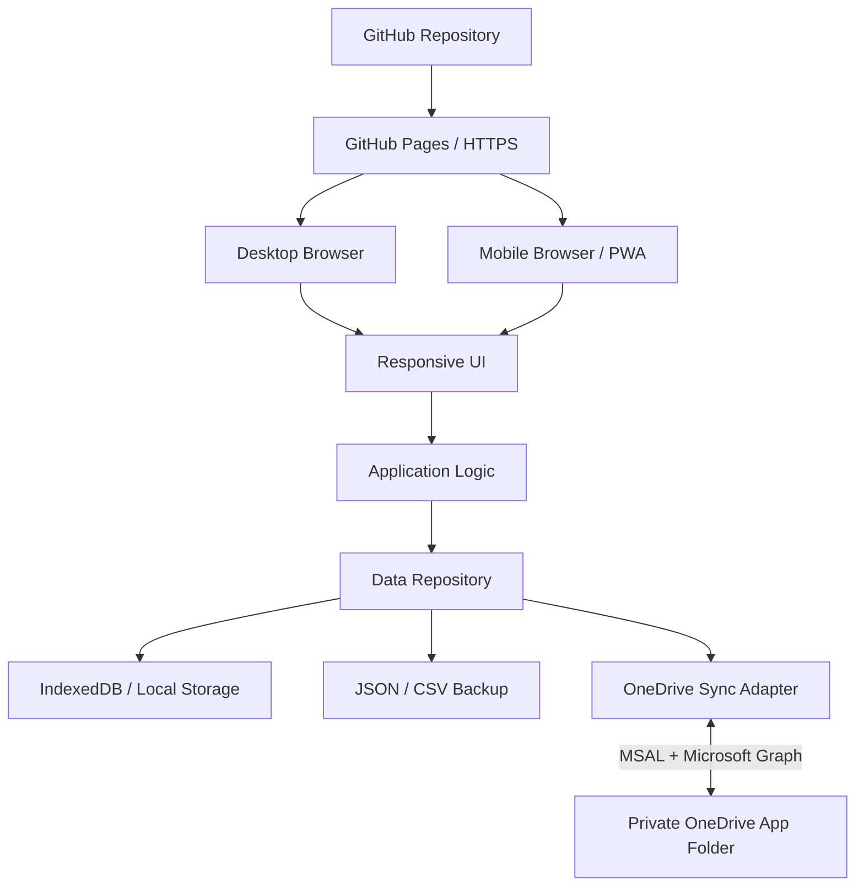

# Health Tracker

> Simple · Responsive · Local-first · Cloud optional

一个面向个人使用的健康追踪网页应用。通过 GitHub Pages 提供手机和电脑端界面，通过浏览器本地数据库保存记录，未来通过 OneDrive 实现跨设备同步。不需要自建服务器，不依赖付费数据库或 AI API。

**项目状态：规划阶段。** 以下功能及版本路线为设计目标，不代表已经实现。

## 1. 项目目标

- 记录体重、运动、睡眠、饮水及日常健康习惯。
- 提供简洁的 Dashboard、趋势图、进度条、历史记录及打卡功能。
- 一套代码适配手机、平板和电脑。
- 支持 PWA 安装及离线使用。
- 本地优先，OneDrive 同步可选；没有网络或云服务时仍能记录。
- 支持 JSON 完整备份和恢复、CSV 数据导出。
- 保持低成本、低依赖、易维护、可迁移。

## 2. 系统架构



| 层级 | 职责 | 技术 |
| --- | --- | --- |
| Hosting | 静态网页发布、HTTPS | GitHub Pages |
| Presentation | 响应式界面、卡片、表单、图表 | HTML、CSS、SVG、Chart.js（可选） |
| Application | 记录、统计、校验、配置 | Vanilla JavaScript |
| Repository | 统一数据读写接口 | JavaScript Modules |
| Local Storage | 本地持久化、离线记录 | IndexedDB；原型可用 LocalStorage |
| Cloud Sync | 可选的跨设备同步 | Microsoft Graph + MSAL.js |
| PWA | 主屏幕入口、离线资源、应用更新 | Web App Manifest + Service Worker |
| Backup | 数据迁移、恢复、分析 | JSON / CSV |

GitHub 只保存代码与非敏感示例；OneDrive 保存个人数据。手机和电脑访问同一个网页，各自维护本地数据库，通过 OneDrive 交换记录。GitHub Pages 本身不提供应用数据库，也不会自动同步用户数据。

## 3. UI 与交互设计

采用 Mobile-first 响应式设计，手机优先，电脑自动扩展布局。

| 页面 | 功能 |
| --- | --- |
| Today / Dashboard | 今日数据卡片、健康习惯、快速记录、同步状态 |
| Trends | 7/30/90 天体重趋势、运动统计、周/月汇总 |
| History | 按日期查看、编辑、删除记录 |
| Settings | 单位、追踪项目、备份恢复、OneDrive 授权 |

设计规范：系统字体、16px 卡片圆角、16px 常规间距、清晰的数据层级、浅色边框、低饱和配色；手机卡片两列（窄屏一列），电脑四列，图表随容器宽度变化。手机使用底部导航，电脑可使用侧栏。交互应支持键盘、足够大的触控区域以及文字状态提示，不仅依赖颜色。

健康数据不预设为强制减重目标；允许自定义指标、休息日和目标，并将缺失值与零区分。

## 4. 建议目录结构

```text
health-tracker/
├── README.md
├── .gitignore
├── index.html
├── css/
│   └── styles.css
├── js/
│   ├── app.js
│   ├── config.js
│   ├── ui.js
│   ├── charts.js
│   ├── repository.js
│   ├── storage.js
│   ├── backup.js
│   └── sync/
│       ├── auth.js
│       └── onedrive.js
├── libs/                 # 可选：固定版本的第三方库及许可证
├── icons/
├── manifest.json
├── sw.js
└── tests/
```

这是目标结构，第一版无需创建所有模块。初期保持少量文件，随功能增加再拆分。实际个人数据、令牌、导出文件不应进入 Git 仓库。

## 5. 数据模型与本地存储

使用统一、带版本号的数据格式。每日单值指标可使用稳定的逻辑键 `trackerId + date`；多次记录型指标使用独立记录 ID。日期采用用户本地日期（YYYY-MM-DD），操作时间采用 UTC ISO 8601。

```json
{
  "schemaVersion": 1,
  "id": "weight:2026-11-26",
  "trackerId": "weight",
  "date": "2026-11-26",
  "value": 59,
  "unit": "kg",
  "updatedAt": "2026-11-25T20:00:00Z",
  "deleted": false
}
```

以上为示例格式，并非实际同步记录。IndexedDB 可设置 `records`、`settings`、`outbox`、`syncMeta` 等 object stores。业务层通过统一 repository 接口操作数据，不直接调用 OneDrive。

```js
await repository.save(record);
await repository.get(id);
await repository.list({ trackerId, from, to });
await repository.remove(id);
await repository.exportBackup();
await repository.sync(); // 云同步启用后实现
```

保存记录和待同步事件应在同一个本地事务中完成，避免记录已保存但同步任务丢失。浏览器数据可能被清除或回收，因此本地存储不是唯一备份。

## 6. OneDrive 同步设计（计划）

### 6.1 授权与访问

- 注册 Microsoft Entra 应用，配置 SPA 和实际 GitHub Pages Redirect URI。
- 支持个人 Microsoft 账户（具体账户类型及租户注册权限需验证）。
- 使用 MSAL.js、OAuth 2.0 Authorization Code + PKCE；静态前端不使用 Client Secret。
- 优先验证委托权限 `Files.ReadWrite.AppFolder`，限制访问应用文件夹。
- 通过 Microsoft Graph 获取 `GET /me/drive/special/approot`。
- 未授权、授权过期或网络失败时，保留本地记录并提示重新连接。

### 6.2 同步协议：独立事件文件

建议同步不可变的操作事件，而不是由多台设备覆盖同一个完整 JSON 文件。

```text
OneDrive App Folder/
├── events/
│   └── 2026-11/
│       ├── <event-uuid-1>.json
│       └── <event-uuid-2>.json
└── backups/              # 可选的完整备份
```

```json
{
  "schemaVersion": 1,
  "eventId": "<uuid>",
  "recordId": "weight:2026-11-26",
  "operation": "upsert",
  "deviceId": "<device-uuid>",
  "baseEventId": null,
  "createdAt": "2026-11-25T20:00:00Z",
  "payload": { "trackerId": "weight", "date": "2026-11-26", "value": 59, "unit": "kg" }
}
```

同步流程：本地保存 → 加入 outbox → 上传唯一事件文件 → 确认成功后移除待上传标记 → 拉取远端事件 → 按 eventId 去重 → 重建或更新本地记录。

不同记录直接合并。同一记录从同一基础版本分叉时，保留两个版本并标记冲突，由用户选择；解决操作产生新事件并引用被解决的事件。不要只依赖设备时钟决定胜负。删除使用 tombstone 事件，避免旧设备恢复已删除记录。重复上传使用同一 eventId；若远端已存在则核对内容，避免静默覆盖。

初期可按月目录扫描并处理分页；数据量增长后再考虑增量查询、快照及归档。归档不能破坏离线设备尚未同步的历史。网络失败时保留 outbox，按退避策略重试并遵守 API 限流。

同步触发：打开应用、保存记录、恢复网络、返回前台及手动 Sync。不保证关闭应用后的后台同步。

同步状态：Local only / Pending / Syncing / Synced / Offline / Conflict / Error。只有远端上传及拉取成功且无待处理操作时才显示 Synced。

## 7. GitHub Pages 与手机使用

1. 将 `index.html` 等静态资源提交到 `main` 分支。
2. 在 GitHub 仓库 Settings → Pages 中选择 Deploy from a branch，选择 `main` 和 `/ (root)`。
3. 部署后访问 `https://<github-username>.github.io/health-tracker/`（占位地址，以实际 Pages URL 为准）。
4. iPhone 使用 Safari 的分享菜单添加到主屏幕；Android 使用 Chrome 的安装或添加到主屏幕入口。
5. PWA 阶段增加 manifest、应用图标及 Service Worker；资源路径使用相对路径，避免项目子路径部署错误。

Manifest 建议采用 `start_url: "./"`、`scope: "./"`、`display: "standalone"`。Service Worker 仅缓存应用静态资源，不缓存 Graph API 响应或授权信息；通过缓存版本更新机制避免旧资源混用。首次离线使用前需要在线加载成功。

代码更新通过 Git push 发布，数据无需随代码重新部署。公开 Pages 网站不是私有应用，个人数据必须依赖 Microsoft 授权保护。

## 8. 版本路线图

| 版本 | 目标 | 主要交付 | 验收标准 |
| --- | --- | --- | --- |
| V1.0 | Local Tracker | 响应式 Dashboard、每日记录、编辑删除、基础图表、本地保存、GitHub Pages | 手机及电脑正常显示；刷新后记录保留 |
| V1.1 | Data Architecture | IndexedDB、Repository、数据版本、JSON 导入导出、CSV 导出 | 备份恢复不丢数据；旧数据可迁移 |
| V2.0 | Offline PWA | Manifest、图标、Service Worker、离线页面、更新机制 | 手机主屏幕可启动；首次在线加载后可离线记录 |
| V2.1 | Manual Sync | JSON 跨设备导入、去重、合并、冲突提示 | 两设备独立记录合并后不重复、不丢失 |
| V2.2 | OneDrive Auto Sync | MSAL 登录、Graph App Folder、outbox、事件上传拉取、同步状态 | 两台设备联网时同步；离线恢复、重复提交、删除及冲突测试通过 |
| V3.0 | Extensible Tracker | 配置驱动的指标、更多报告、可选通用 Tracker 模块 | 新增指标无需重写核心存储及同步逻辑 |

### OneDrive POC（建议提前并行验证，不阻塞 V1.0）

- [ ] 验证 Microsoft 账户与应用注册权限。
- [ ] GitHub Pages 上完成 SPA 登录及重定向。
- [ ] 使用最小权限读取 App Folder。
- [ ] 上传、读取、列出测试 JSON 文件。
- [ ] 第二台设备读取同一文件。
- [ ] 验证退出登录、令牌过期及重新授权。
- [ ] 验证独立事件合并与离线重试。

若授权不可行，保留本地 PWA + 手动备份同步路线，不影响核心应用。

## 9. 安全、维护与成本

- 不提交个人健康记录、Client Secret、Access Token、Refresh Token 或私有备份；公开 Client ID 不是秘密。
- 使用 HTTPS，避免不必要的第三方脚本；固定依赖版本并保留许可证。
- 校验导入文件结构、版本及大小；用户输入使用安全文本渲染，避免 XSS。
- 明确退出登录时如何处理本地缓存与待同步记录；切换账户时隔离数据，避免跨账户上传。
- OneDrive 数据由账户权限保护，但默认不等同于应用端到端加密；共享设备仍需注意本地数据隐私。
- 定期备份并测试恢复；删除数据时考虑同步事件与备份中的历史副本。
- GitHub Pages 公开仓库托管、开源库及现有 OneDrive 额度通常可满足个人使用；不承诺未来服务永久免费，实际账户、额度与政策需确认。
- 优先维护少量依赖与稳定接口，不引入不必要的框架、后台服务或商业 SaaS。

## 10. 参考文档

- [GitHub Pages](https://docs.github.com/en/pages/getting-started-with-github-pages/creating-a-github-pages-site)
- [Microsoft Graph OneDrive App Folder](https://learn.microsoft.com/en-us/graph/onedrive-sharepoint-appfolder)
- [MSAL Browser](https://learn.microsoft.com/en-us/entra/msal/javascript/browser/about-msal-browser)
- [MDN Progressive Web Apps](https://developer.mozilla.org/en-US/docs/Web/Progressive_web_apps)
- [MDN IndexedDB](https://developer.mozilla.org/en-US/docs/Web/API/IndexedDB_API)
- [Chart.js](https://www.chartjs.org/docs/latest/)

---

**Development principle:** Build the UI first, protect the data, validate sync early, and keep the cloud optional.

目前尚未验证实际仓库部署、Microsoft 账户授权、浏览器兼容性或同步协议实现；以上内容是开发设计及验收路线，不是已通过测试的功能声明。
